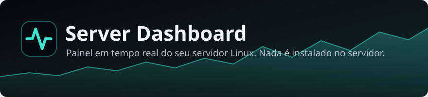
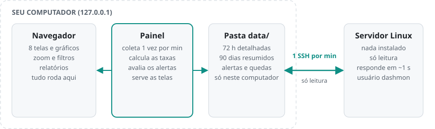
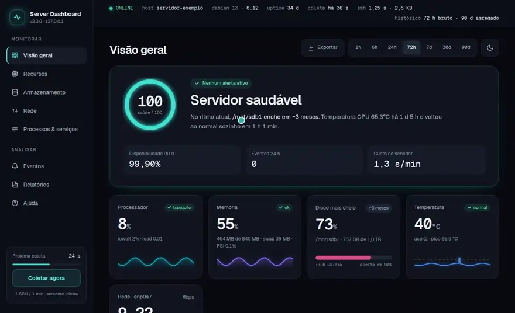

# Server Dashboard

**Painel em tempo real do seu servidor Linux, no navegador. Nada é instalado no servidor.**

<picture><source media="(prefers-color-scheme: dark)" srcset="docs/img/visao-geral-escuro.webp"></picture>

Uma vez por minuto, o painel conecta no servidor por SSH, lê dezenas de métricas e mostra
tudo em gráficos. Ele roda no **seu computador**: o servidor só responde 1 comando de
leitura por minuto. Funciona até em hardware muito limitado (1 núcleo, pouca RAM).

> **Versão 2.** Mudanças: [CHANGELOG.md](CHANGELOG.md). Decisões de projeto:
> [docs/adr/](docs/adr/README.md). A V1 continua na tag
> [`v1.0.0`](https://github.com/tsouza-thiago/linux-server-dashboard-v2/releases/tag/v1.0.0).

<picture><source media="(prefers-color-scheme: dark)" srcset="docs/img/arquitetura-escuro.svg"></picture>

**Novo por aqui?** Siga o [Tutorial passo a passo](TUTORIAL.md).

---

## <picture><source media="(prefers-color-scheme: dark)" srcset="docs/img/icones/garantias-escuro.svg"></picture> Garantias

- **O servidor só é lido.** O painel não instala, não grava e não roda nada além do
  comando de leitura. Nada de agente, serviço ou script deixado lá.
- **1 conexão por minuto**, com um único comando.
- **Acesso mínimo.** O painel entra no servidor com um usuário próprio (`dashmon`, sem
  senha). A chave dele só roda a coleta e só a partir do seu computador. O `sudo` dele vale
  só para o teste de saúde dos discos (`smartctl -H`), disco por disco.
- **Senha só na instalação.** A senha do servidor fica na memória e é descartada no fim.
- **Painel só neste computador** (`127.0.0.1`), com login, proteção contra sites
  maliciosos e arquivos legíveis só por você.
- **Versões assinadas.** A instalação e a atualização só aceitam versões assinadas pela
  chave do projeto.

Detalhes e modelo de ameaças: [SECURITY.md](SECURITY.md).

---

## <picture><source media="(prefers-color-scheme: dark)" srcset="docs/img/icones/telas-escuro.svg"></picture> O que ele mostra

| Tela | O que mostra |
|---|---|
| **Visão geral** | Saúde de 0 a 100 com o motivo, disponibilidade, indicadores e telemetria |
| **Recursos** | Processador, carga, memória, swap, temperatura e pressão do sistema (PSI) |
| **Armazenamento** | Espaço por pasta, **previsão de quando enche**, atividade e saúde (SMART) dos discos |
| **Rede** | Download, upload, picos, erros e volume por dia |
| **Processos & serviços** | Serviços com histórico de quedas e processos que mais usam memória |
| **Eventos** | Alertas, quedas e anotações numa linha do tempo, com disponibilidade de 90 dias |
| **Relatórios** | Resumo de 7, 30 ou 90 dias, exportação CSV/JSON e impressão |
| **Ajuda** | O que fazer em cada alerta, atalhos e a configuração ativa |

Histórico: 72 horas detalhadas (1 ponto por minuto) e 90 dias resumidos (a cada 5 min).
Tema escuro e claro.

<table>
<tr><td width="50%" align="center"><strong>Recursos</strong><br><picture><source media="(prefers-color-scheme: dark)" srcset="docs/img/recursos-escuro.webp"></picture></td><td width="50%" align="center"><strong>Armazenamento</strong><br><picture><source media="(prefers-color-scheme: dark)" srcset="docs/img/armazenamento-escuro.webp"></picture></td></tr>
<tr><td width="50%" align="center"><strong>Rede</strong><br><picture><source media="(prefers-color-scheme: dark)" srcset="docs/img/rede-escuro.webp"></picture></td><td width="50%" align="center"><strong>Eventos</strong><br><picture><source media="(prefers-color-scheme: dark)" srcset="docs/img/eventos-escuro.webp"></picture></td></tr>
</table>

Trocar de tela e percorrer um gráfico acontece no navegador, sem nenhuma conexão a mais com o
servidor:



Todas as imagens saem de um painel de teste, com dados inventados.

---

## <picture><source media="(prefers-color-scheme: dark)" srcset="docs/img/icones/requisitos-escuro.svg"></picture> Requisitos

- **Este computador:** Linux (Debian, Ubuntu, Mint ou Fedora; ADR 0013) com `git`:
  ```bash
  sudo apt install git     # Debian, Ubuntu, Mint
  sudo dnf install git     # Fedora
  ```
- **O servidor:** Linux ligado e na rede, com `sshd` ativo e um usuário que possa usar
  `sudo` (só na instalação). Servidor que só aceita chave SSH também serve: o assistente
  entra pelo apelido do seu `~/.ssh/config`, com a chave no ssh-agent.

Não precisa instalar o Node.js: se faltar, o `./dashboard` baixa o Node 24 oficial para
dentro da pasta (`.runtime/`) e confere o SHA-256. Não precisa de `npm install`.

---

## <picture><source media="(prefers-color-scheme: dark)" srcset="docs/img/icones/instalar-escuro.svg"></picture> Instalar

```bash
git clone https://github.com/tsouza-thiago/linux-server-dashboard-v2.git && cd linux-server-dashboard-v2 && ./dashboard instalar
```

O `./dashboard instalar` confere a versão assinada, o Node e a porta, e abre o
**assistente no navegador** com um código de uso único. São 6 passos:

1. **Boas-vindas:** o que será feito e o que nunca é feito.
2. **Servidor:** como você entra (senha ou chave SSH), endereço e usuário administrador.
3. **Conectar:** você confere a identidade do servidor **antes** de digitar a senha.
4. **O que monitorar:** pastas, discos, rede, serviços e limites, já marcados como recomendado.
5. **Preparar o servidor:** *assistido* (mostra os comandos exatos e roda depois do seu
   "Confirmar") ou *à mão* (você cola os blocos e clica em Testar).
6. **Pronto:** primeira leitura real; o painel abre já logado.

Sem tela? `./dashboard instalar --terminal` faz os mesmos passos no terminal. Para
automatizar: `./dashboard instalar --sem-interface --ajuda`.

A instalação também cria o comando `dashboard`, que roda de qualquer pasta e sem o `./`. Ele é um
link em `~/.local/bin` e não pede sudo. Ela liga também o autocomplete do bash: `dashboard atu` +
Tab vira `dashboard atualizar`, e as opções completam do mesmo jeito. Para pular os 2, use
`--sem-link`. Já tinha o painel instalado? Rode `./dashboard reconfigurar`: o assistente oferece
criar o comando.

---

## <picture><source media="(prefers-color-scheme: dark)" srcset="docs/img/icones/comandos-escuro.svg"></picture> Comandos

Na pasta do projeto:

| Comando | O que faz |
|---|---|
| `./dashboard abrir` | Abre o painel no navegador, já logado |
| `./dashboard status` | Mostra se o painel está rodando |
| `./dashboard iniciar` / `./dashboard parar` | Liga ou desliga o painel (o servidor não é afetado) |
| `./dashboard diagnosticar` | Testa tudo e explica cada problema |
| `./dashboard reconfigurar` | Reabre o assistente (outro servidor, disco novo, outro serviço) |
| `./dashboard atualizar` | Instala a versão assinada mais nova, com backup; volta atrás se falhar |
| `./dashboard desinstalar` | Remove o painel e o comando deste computador e oferece limpar a parte dele no servidor |
| `./dashboard versao` | Mostra a versão |

Depois de instalado, o painel inicia com o computador (serviço systemd **de usuário**) e
aparece no menu como **Server Dashboard**.

---

## <picture><source media="(prefers-color-scheme: dark)" srcset="docs/img/icones/v1-escuro.svg"></picture> Vindo da V1

Clone a V2 numa pasta nova e rode:

```bash
./dashboard instalar --importar-v1 ~/linux-server-dashboard
```

Isto para a V1, traz a configuração e o histórico e liga a V2 com o mesmo acesso SSH da V1.
A pasta da V1 **não é alterada**. Depois, rode `./dashboard reconfigurar` para trocar o
acesso completo da V1 pela chave restrita à coleta.

Para voltar à V1: na pasta da V2, `systemctl --user disable --now server-dashboard` (não
inicia mais com o computador) e, na pasta da V1, `./start.sh --background`.

---

## <picture><source media="(prefers-color-scheme: dark)" srcset="docs/img/icones/problemas-escuro.svg"></picture> Problemas?

1. Rode `./dashboard diagnosticar`. Ele diz o que aconteceu e como resolver.
2. Veja a seção [Solução de problemas](TUTORIAL.md#9-solução-de-problemas) do tutorial.
3. Logs: `data/dashboard.log` e `journalctl --user -u server-dashboard`.

---

## <picture><source media="(prefers-color-scheme: dark)" srcset="docs/img/icones/perguntas-escuro.svg"></picture> Perguntas frequentes

**Pesa no servidor?** Não. Ele responde 1 comando leve por minuto (cerca de 1 segundo
num servidor de 1 núcleo). Gráficos, histórico e alertas rodam no seu computador.

**Grava algo no servidor?** A coleta, nunca. Só a instalação cria o usuário `dashmon`, a
chave dele e a regra do `sudo`. O `./dashboard desinstalar` oferece remover os três.

**Quanto espaço usa aqui?** Cerca de 16 MB para 72 horas detalhadas e 29 MB para 90 dias
resumidos, em `data/`.

**E se o servidor desligar?** O painel avisa, guarda o histórico e tenta de novo a cada
minuto. Quando o servidor volta, ele se recupera sozinho.

**Posso abrir de outro computador?** Não diretamente: o painel só existe em `127.0.0.1`,
de propósito. Para acesso remoto, use VPN ou túnel SSH.

---

## <picture><source media="(prefers-color-scheme: dark)" srcset="docs/img/icones/documentacao-escuro.svg"></picture> Documentação

| Documento | Para quem |
|---|---|
| [TUTORIAL.md](TUTORIAL.md) | Quem vai instalar e usar: passo a passo, telas, glossário e problemas |
| [SECURITY.md](SECURITY.md) | Quem quer auditar: modelo de ameaças e como reportar falhas |
| [AGENTS.md](AGENTS.md) | Quem desenvolve: regras, configuração, coleta, API, formato dos dados |
| [CHANGELOG.md](CHANGELOG.md) | Mudanças de cada versão |
| [docs/adr/](docs/adr/README.md) | Decisões de projeto (ADRs) e análises de segurança em `docs/seguranca/` |

## <picture><source media="(prefers-color-scheme: dark)" srcset="docs/img/icones/licenca-escuro.svg"></picture> Licença

**MIT**: use, modifique e compartilhe com atribuição (veja `LICENSE`).
