# Tutorial — Server Dashboard

Guia completo, passo a passo, para instalar, iniciar, parar e usar o **Server Dashboard**:
o painel que mostra em tempo real o que acontece no seu servidor Linux
(ex.: um Debian modesto na sua rede local).

> [!TIP]
> **Para leigos:** se você nunca abriu um terminal, siga as seções **1**, **2** e **3**
> na ordem. Cada comando foi escrito para copiar e colar. Não precisa decorar nada.

---

## Índice

1. [O que é este programa?](#1-o-que-é-este-programa)
2. [Antes de começar (pré-requisitos)](#2-antes-de-começar-pré-requisitos)
3. [Instalação (assistente no navegador)](#3-instalação-assistente-no-navegador)
4. [Abrir, iniciar e parar](#4-abrir-iniciar-e-parar)
5. [Atualizar, reconfigurar e desinstalar](#5-atualizar-reconfigurar-e-desinstalar)
6. [Como usar o dashboard](#6-como-usar-o-dashboard)
7. [Entendendo os números (glossário para leigos)](#7-entendendo-os-números-glossário-para-leigos)
8. [Alertas: o que significam e o que fazer](#8-alertas-o-que-significam-e-o-que-fazer)
9. [Solução de problemas](#9-solução-de-problemas)
10. [Dicas e boas práticas](#10-dicas-e-boas-práticas)

---

## 1. O que é este programa?

O **Server Dashboard** é um "painel de controle" que fica no seu computador e mostra,
a cada 60 segundos, como está o seu servidor:

- uso de **CPU** (carga) e **memória RAM**;
- **temperatura** do processador;
- espaço livre em cada **disco** e previsão de quando podem encher;
- **tráfego de rede** (download/upload);
- **I/O dos discos** (leitura/escrita);
- **serviços** (smbd/nmbd ou outros) ativos ou parados;
- **saúde dos discos** (SMART);
- os **processos** que mais consomem memória;
- **alertas** quando algo está errado (disco quase cheio, temperatura alta, servidor fora do ar).

Como ele faz isso? Uma vez por minuto, ele conecta no servidor por SSH, lê as informações
e mostra em gráficos. **Nada é instalado no servidor**, e a conexão só lê.

### O que é a "saúde 0–100"?

Na tela **Visão geral**, um anel mostra uma nota de 0 a 100. Ela começa em 100 e perde
pontos a cada problema: carga alta, RAM, temperatura, disco cheio, SMART com falha ou
serviço parado. O motivo aparece ao lado da nota.

| Nota | Cor | Significado |
|------|-----|-------------|
| 80–100 | verde | saudável |
| 50–79 | amarelo | atenção |
| 0–49 | vermelho | crítico |

---

## 2. Antes de começar (pré-requisitos)

Só são necessários 3 itens:

1. **O `git`** neste computador (é o único momento em que algo pede a sua senha aqui):
   ```bash
   sudo apt install git     # Debian, Ubuntu, Mint
   sudo dnf install git     # Fedora
   ```
2. **O servidor ligado e na mesma rede**.
3. **Um usuário do servidor que possa usar `sudo`**, e a senha dele (usada uma vez).

> [!NOTE]
> Não precisa instalar o Node.js nem configurar chave SSH: o `./dashboard` baixa o Node 24
> oficial para dentro da pasta (conferido) e o assistente cria uma chave só para o painel.

---

## 3. Instalação (assistente no navegador)

A instalação é uma única vez. Abra um terminal, copie e cole:

```bash
git clone https://github.com/tsouza-thiago/linux-server-dashboard-v2.git && cd linux-server-dashboard-v2 && ./dashboard instalar
```

O terminal mostra uma lista de verificações (versão assinada, Node.js, pasta `data/`,
porta) e **abre o assistente no navegador** sozinho. Se o navegador não abrir, copie o
endereço e o **código de uso único** que aparecem no terminal.

> [!IMPORTANT]
> Deixe o terminal aberto até o fim do assistente.

### Os 6 passos

1. **Boas-vindas** — o que será feito e o que nunca é feito. Clique em **Começar**.

   

2. **Servidor** — escolha como você entra no servidor. Com **Senha** (o comum), informe o
   endereço (ex.: `192.0.2.10`; no servidor, `hostname -I` mostra) e o seu usuário dele.
   Com **Chave SSH** (servidor que só aceita chave), informe o apelido que você usa no
   terminal (o de `ssh meu-servidor`) e clique em **Ler o apelido**: confira o endereço, a
   porta, o usuário e a chave. O assistente confere se o servidor responde.

   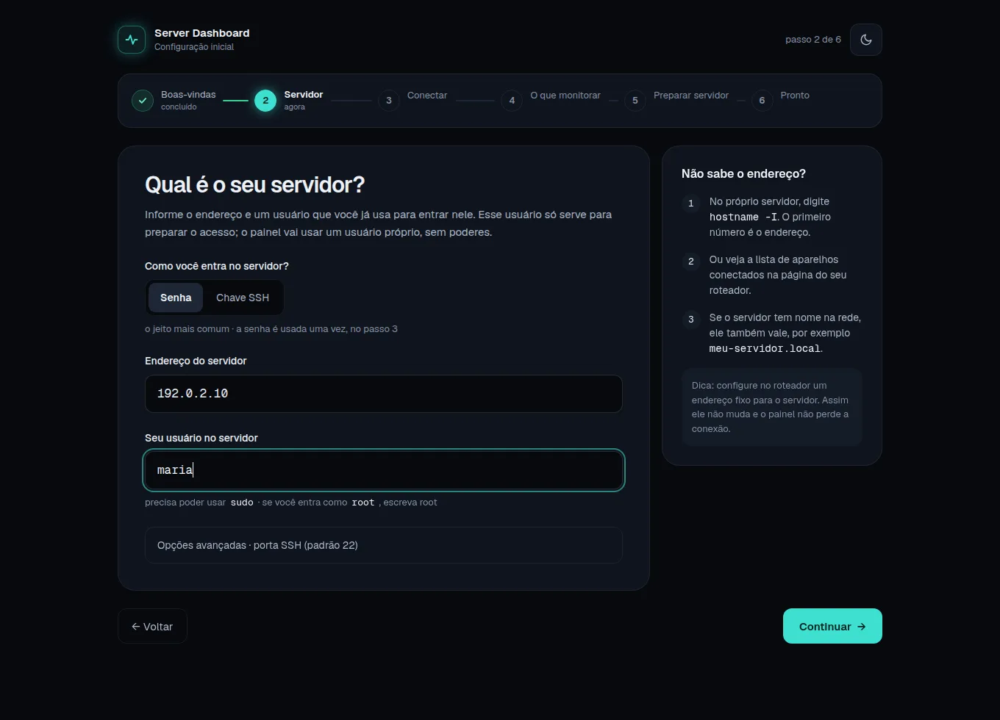

3. **Conectar** — aparece a **identidade do servidor** em blocos de letras. Se quiser
   conferir, rode no servidor `ssh-keygen -lf /etc/ssh/ssh_host_ed25519_key.pub`: as letras
   devem ser iguais. Marque "Este é o meu servidor", digite a senha e clique em
   **Conectar** (1 conexão só de leitura; nada muda no servidor ainda). Escolheu **Chave
   SSH**? Não há senha aqui: a chave precisa estar no seu ssh-agent. Se ela faltar, o
   assistente mostra o comando (ex.: `ssh-add -t 15m ~/.ssh/minha_chave`); rode no seu
   terminal, digite a passphrase lá e clique em **Tentar de novo**. O painel nunca pede a
   passphrase. Apelido com `ProxyJump` não serve: o painel conecta direto ao servidor.

   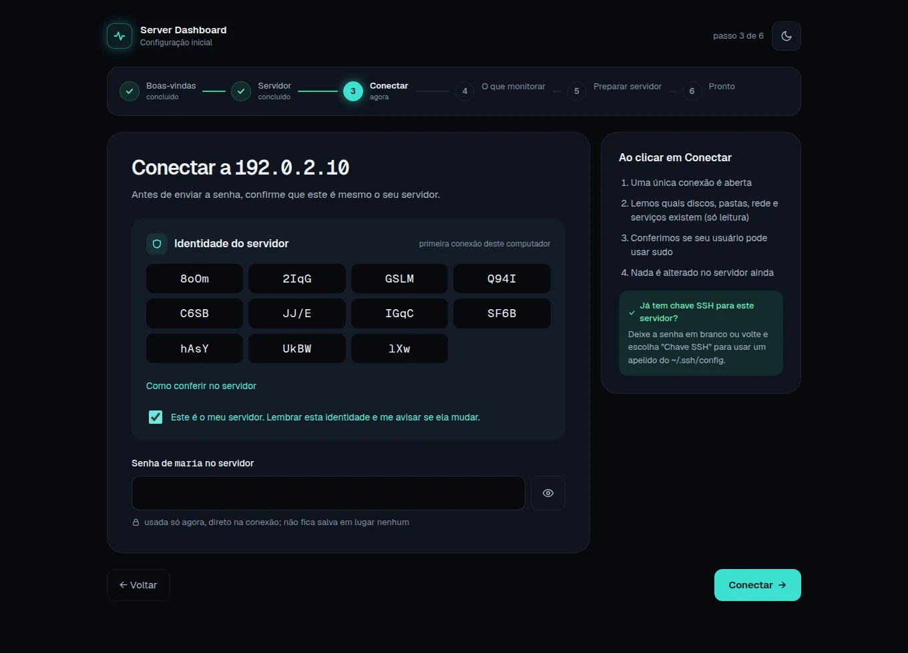

4. **O que monitorar** — discos, pastas, rede e serviços que o assistente encontrou, já
   marcados como recomendado, e os limites de aviso. O resumo ao lado mostra o custo
   estimado no servidor (cerca de 1 segundo por coleta, num servidor de 1 núcleo).

   

5. **Preparar o servidor** — confira os comandos exatos e clique em **Confirmar e
   preparar** (*assistido*), ou escolha **Prefiro fazer à mão** e cole os blocos no
   servidor, clicando em **Testar** depois de cada um. Isso cria o usuário `dashmon`, sem
   senha, com uma chave que só roda a coleta, e libera o teste de saúde dos discos. Se o
   `sudo` pedir senha e você entrou por chave, digite a senha da sua conta no servidor (não a
   passphrase). Antes de mudar algo, o assistente confere (só lendo) se o SSH do servidor
   vai aceitar o `dashmon` e avisa o que ajustar, como o `AllowUsers`; ele nunca muda o
   `sshd_config`. Se o servidor tem `Defaults requiretty` no sudo, use **Prefiro fazer à
   mão**.

   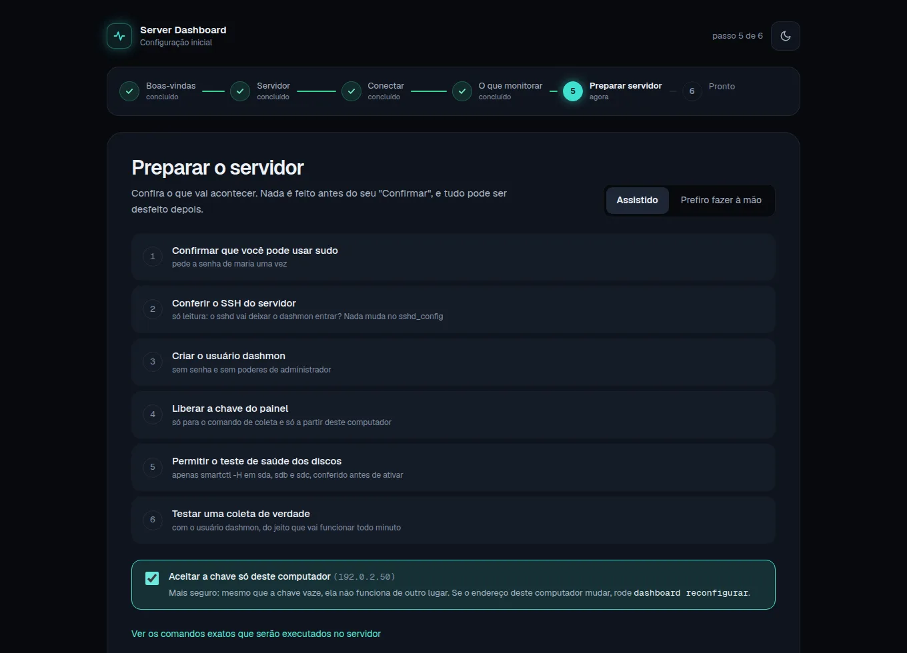

6. **Pronto** — a primeira leitura real do servidor. Escolha "iniciar com o computador",
   o atalho no menu e os avisos do navegador, e clique em **Abrir o painel**: o assistente
   se desliga e o painel abre já logado.

   

> [!TIP]
> **Máquina sem tela?** `./dashboard instalar --terminal` faz os mesmos 6 passos no
> terminal (setas, espaço e Enter).

---

## 4. Abrir, iniciar e parar

Depois de instalado, o painel liga sozinho com o computador e aparece no menu de
aplicativos como **Server Dashboard**. Pelo terminal, na pasta do projeto:

```bash
./dashboard abrir      # abre o painel no navegador, já logado
./dashboard status     # está rodando?
./dashboard parar      # para (o servidor não é afetado; o histórico fica salvo)
./dashboard iniciar    # liga de novo
```

A instalação também cria o comando `dashboard`. Com ele, você roda tudo de qualquer pasta e
sem o `./`, por exemplo `dashboard abrir`. Ele vale no próximo login. Até lá, use o caminho
completo que a instalação mostrou. Se `~/.local/bin` não estiver no seu PATH, a instalação pergunta
se pode acrescentar a pasta no arquivo de login, e guarda uma cópia antes. Instalou antes desta
versão? Rode `./dashboard reconfigurar`: o último passo oferece criar o comando.

Num terminal novo, a tecla **Tab** completa os comandos e as opções: `dashboard atu` + Tab vira
`dashboard atualizar`. Em `--chave-ssh`, ela sugere os apelidos do seu `~/.ssh/config` (só desse
arquivo, sem os de `Include`). Sem o pacote `bash-completion`, a instalação pergunta se pode
acrescentar um bloco no `~/.bashrc`, e guarda uma cópia antes. Só funciona no bash.

O painel só existe **neste computador** (`http://127.0.0.1:3000`): ninguém mais na rede
consegue abrir, de propósito. Em outro navegador, ele pede o **token de reserva** (o
assistente mostra uma vez; ele também fica no `.env`).

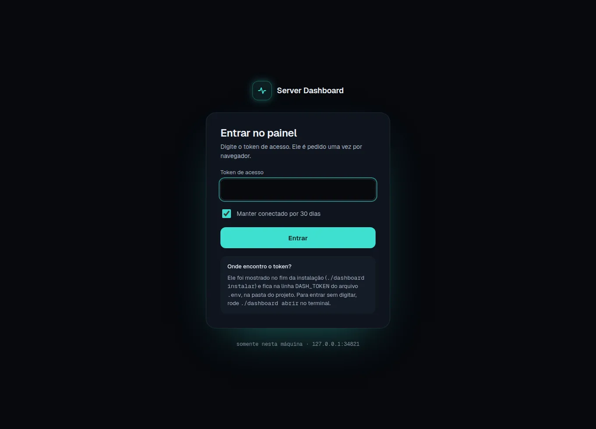

### Algo parece errado?

```bash
./dashboard diagnosticar
```

Ele confere tudo (painel, permissões, servidor, chave, teste de saúde dos discos, última
coleta) e explica cada problema com "O que aconteceu" e "Como resolver".

---

## 5. Atualizar, reconfigurar e desinstalar

```bash
./dashboard atualizar      # versão assinada mais nova; faz backup e volta atrás se falhar
./dashboard reconfigurar   # trocar servidor, discos, pastas ou serviços (reabre o assistente)
./dashboard desinstalar    # remove daqui e oferece limpar a parte deste computador no servidor
```

**Rode na pasta da instalação.** O `atualizar` só vale na pasta onde o painel foi instalado.
Numa cópia sem `.env`, ou com o serviço em outra pasta, ele para sem alterar nada e mostra a pasta
certa. Para o serviço mudar de pasta de propósito, rode `./dashboard reconfigurar` na pasta nova.

**Mais de um computador com o painel?** Pode. Cada computador tem a sua chave e a sua
linha no servidor, e uma instalação não apaga a outra. Cada painel faz a sua coleta: com 2
computadores, o servidor recebe 2 conexões por minuto. O `desinstalar` tira só a parte do
computador onde ele roda.

**Vindo da V1?** Clone a V2 numa pasta nova e rode
`./dashboard instalar --importar-v1 ~/linux-server-dashboard`: a V1 é parada, as
configurações e o histórico vêm junto e a pasta da V1 fica intacta (para voltar, se
precisar). Depois, `./dashboard reconfigurar` troca o acesso completo da V1 pela chave
restrita à coleta.

Para voltar à V1: na pasta da V2, `systemctl --user disable --now server-dashboard` (para
a V2 e impede que ela volte a iniciar com o computador) e, na pasta da V1,
`./start.sh --background`. As duas juntas fariam 2 conexões por minuto ao servidor.

---

## 6. Como usar o dashboard

O painel tem 8 telas, listadas na coluna esquerda (ou nas teclas `1` a `8`).

| Tela | O que mostra |
|------|--------------|
| **1 Visão geral** | Anel de saúde 0–100 com a frase "Servidor saudável" / "Atenção" / "Crítico" e por quê; disponibilidade de 90 dias e custo da coleta no servidor; 5 indicadores (processador, memória e temperatura com mini-gráfico; disco mais cheio com medidor e previsão; rede com barras); telemetria em faixas com cursor sincronizado; resumo de discos, eventos e processos |
| **2 Recursos** | CPU empilhada (usuário, sistema, espera de disco), carga, memória (média, pico, tendência, swap), temperatura com o limite e os sensores, pressão do sistema (PSI) |
| **3 Armazenamento** | Espaço e inodes por ponto de montagem, **previsão de lotação** com as datas do alerta e de "cheio", atividade de cada disco (ocupação, leitura/gravação, latência) e saúde SMART |
| **4 Rede** | Download e upload agora com o pico do período, volume do dia, erros e descartes, tráfego no período, volume por dia (7 dias) e maiores picos |
| **5 Processos & serviços** | Cada serviço com o histórico de quedas, os processos que mais usam memória (busca e ordenação) e "para onde vai a memória" |
| **6 Eventos** | Disponibilidade de 90 dias dia a dia (conta só o tempo em que o painel estava medindo; dia sem coleta fica cinza, "sem dados"); linha do tempo única de alertas, quedas e anotações, agrupada por dia; filtros; reconhecer; anotar; notificações do navegador |
| **7 Relatórios** | Resumo de 7, 30, 90 dias ou de datas escolhidas, tabela por dia (fuso local) com disponibilidade e eventos; exportação CSV/JSON; impressão/PDF |
| **8 Ajuda** | O que fazer em cada alerta, como ler o painel, atalhos, configuração ativa (só leitura), acesso ao servidor (linha do sudoers para copiar), versões e sessão |

Cada tela, em imagem (com dados inventados, de um painel de teste):

**1 Visão geral**

<picture><source media="(prefers-color-scheme: dark)" srcset="docs/img/visao-geral-escuro.webp">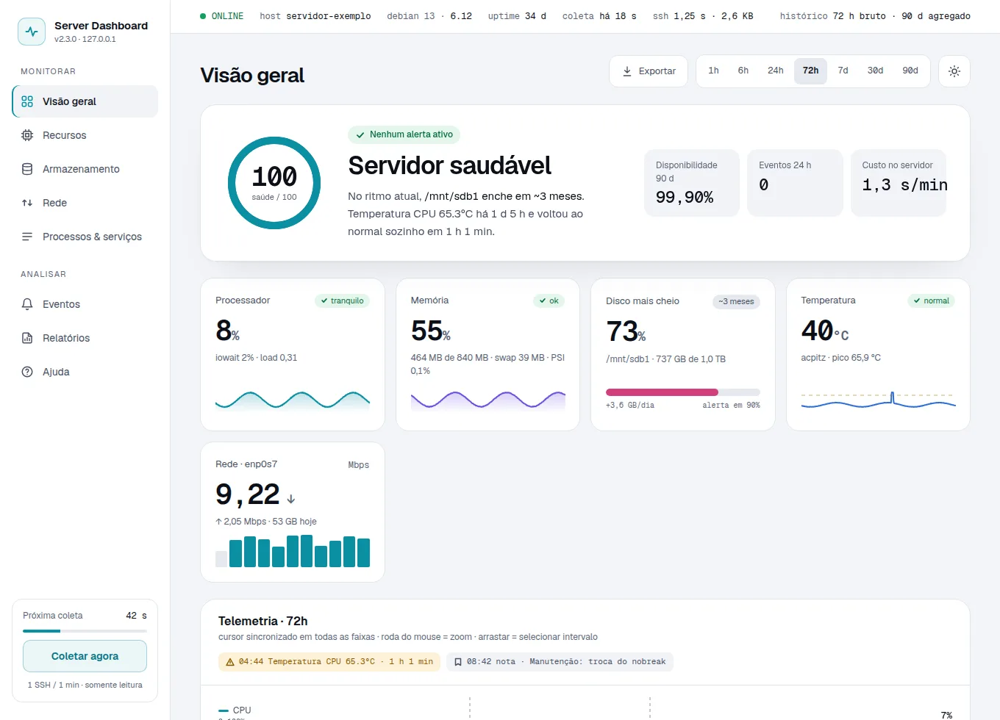</picture>

**2 Recursos**

<picture><source media="(prefers-color-scheme: dark)" srcset="docs/img/recursos-escuro.webp">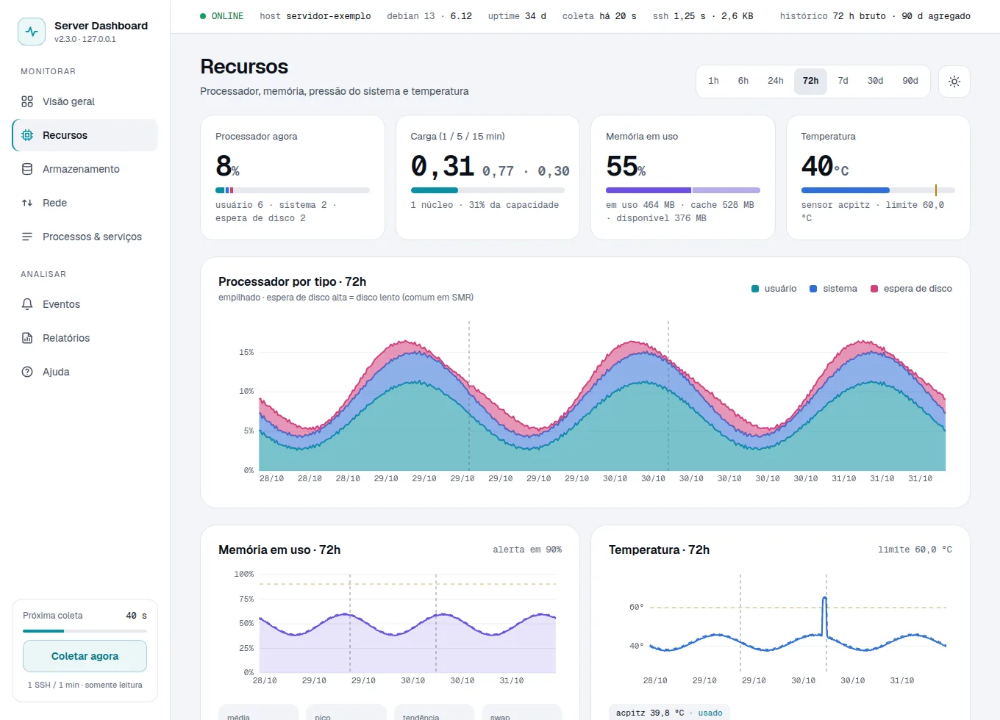</picture>

**3 Armazenamento**

<picture><source media="(prefers-color-scheme: dark)" srcset="docs/img/armazenamento-escuro.webp">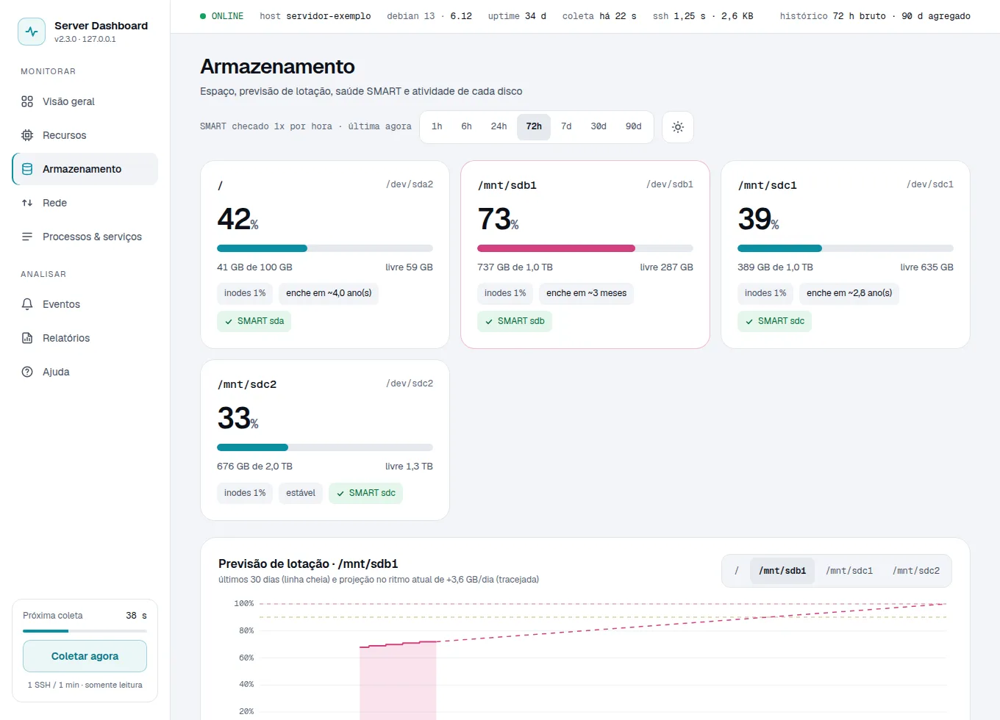</picture>

**4 Rede**

<picture><source media="(prefers-color-scheme: dark)" srcset="docs/img/rede-escuro.webp">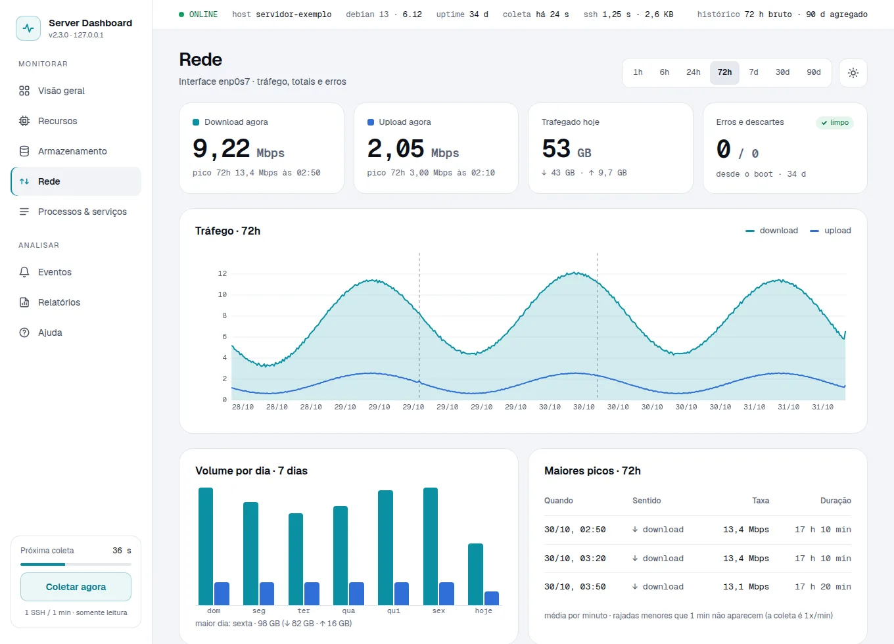</picture>

**5 Processos & serviços**

<picture><source media="(prefers-color-scheme: dark)" srcset="docs/img/processos-escuro.webp">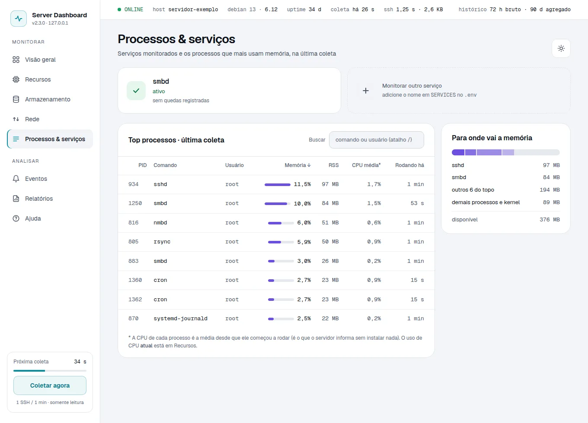</picture>

**6 Eventos**

<picture><source media="(prefers-color-scheme: dark)" srcset="docs/img/eventos-escuro.webp">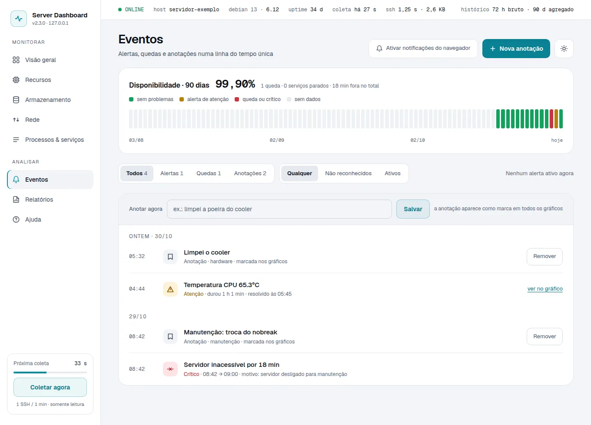</picture>

**7 Relatórios**

<picture><source media="(prefers-color-scheme: dark)" srcset="docs/img/relatorios-escuro.webp">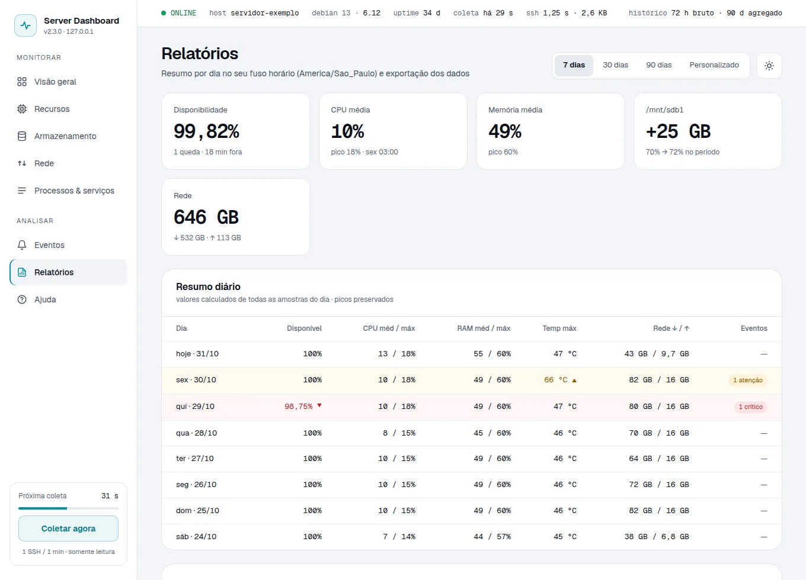</picture>

**8 Ajuda**

<picture><source media="(prefers-color-scheme: dark)" srcset="docs/img/ajuda-escuro.webp">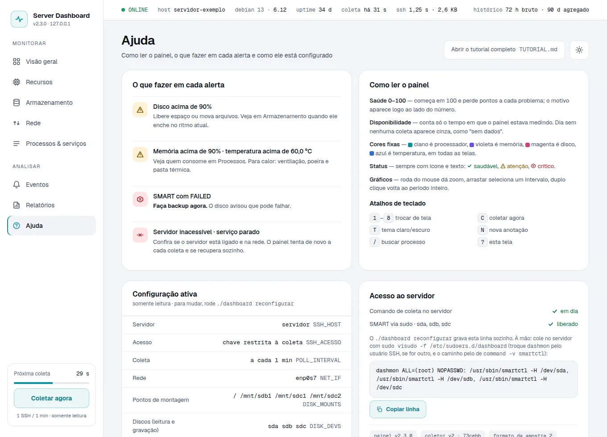</picture>

Dicas por tela:

- **Visão geral** responde "está tudo bem?" em uma frase. Se não estiver, diz o porquê
  ("RAM 92%", "SMART /dev/sda"). O número de 0 a 100 é só um detalhe.
- **Armazenamento** mostra "enche em ~N dias" quando há pelo menos ~1 dia de dados e o
  disco está crescendo; "estável" quando não cresce.
- **Eventos** junta tudo o que aconteceu. Alertas abertos podem ser **reconhecidos**
  (você viu) ou **resolvidos**; ao salvar ou remover uma anotação, aparece **Desfazer** por
  4 s. "Ativar notificações do navegador" avisa alertas novos mesmo com a aba em segundo
  plano.
- **Relatórios** agrupa por dia no fuso do seu computador; "Imprimir / PDF" gera uma versão
  clara e limpa.
- **Servidor fora do ar?** A tela não some: a faixa do topo fica vermelha com o motivo e a
  contagem para a nova tentativa, e os últimos valores ficam em cinza.

### Interações comuns a todas as telas

- **Período**: botões `1h` · `6h` · `24h` · `72h` · `7d` · `30d` · `90d` no topo (fica na URL).
- **Gráficos**: arrastar = aproximar um trecho · roda do mouse = zoom · duplo clique = voltar.
  O cursor fica sincronizado entre os gráficos da tela.
- **Atalhos**: `1`–`8` telas · `C` coletar agora · `T` tema · `N` nova anotação · `/` buscar processo · `?` ajuda.
- **Tema**: escuro é o padrão; o botão da lua/sol (ou `T`) alterna para o claro (fica salvo).
- **Anotações**: em Eventos, marque manutenções ("troquei o cooler"); viram linhas tracejadas nos gráficos.
- **Coletar agora**: força uma coleta imediata, sem esperar o minuto (embaixo do menu, com a
  contagem para a próxima coleta).
- **Faixa de status** no topo: online / coletando / offline, host, sistema, uptime, idade da
  última coleta e quanto ela custou ao servidor (tempo do SSH e tamanho da resposta).
- **Celular**: o menu vira o botão ☰ no canto superior esquerdo.

> [!NOTE]
> A interatividade toda (filtros, zoom, ordenação) acontece **no seu navegador** —
> o servidor não é incomodado por nada disso. A única "conversa" com ele
> continua sendo 1 comando por minuto.

---

## 7. Entendendo os números (glossário para leigos)

| Termo | O que significa | Valor saudável |
|-------|-----------------|----------------|
| **Load (1/5/15)** | Carga do processador na média de 1, 5 e 15 min. Com 1 núcleo, 1,0 = 100% de uso; com 4 núcleos, 4,0 = 100% | abaixo do número de núcleos (a saúde perde pontos acima de 1,5 × os núcleos) |
| **RAM usada** | Memória em uso agora | abaixo de 90% |
| **Swap usada** | Memória "emprestada" do disco. Se estiver subindo, falta RAM | 0 (zero) |
| **Temperatura** | Calor do processador em °C | abaixo de 60 °C |
| **Mbps** | Velocidade de download/upload (megabits por segundo) | — |
| **MB/s** | Velocidade de leitura/escrita dos discos | — |
| **SMART** | Autodiagnóstico de saúde do disco. `SEM_PERMISSAO` = falta a regra do `sudo` (rode `./dashboard reconfigurar`) | `PASSED` |
| **Uptime** | Tempo ligado desde o último boot | — |
| **ETA** | Previsão de quando um disco vai encher (pela tendência de crescimento) | quanto mais longe, melhor |
| **Outage** | Período em que o servidor ficou inacessível | nenhum |

### Sinais de alerta que você deve conhecer

- **Load acima do número de núcleos** — o processador está saturado.
- **RAM ≥ 90%** — quase sem memória; o sistema começa a usar swap e fica lento.
- **Swap subindo** — falta memória; considere fechar serviços pesados.
- **Temperatura ≥ 60 °C** — cuidado com o calor; verifique ventilação/poeira.
- **Disco ≥ 90%** — risco de encher; libere espaço (principalmente em `/`).
- **SMART com FAILED** — o disco avisou que pode falhar; faça backup urgente.
- **Serviço monitorado parado** — algo que deveria estar no ar caiu.

---

## 8. Alertas: o que significam e o que fazer

| Alerta | Nível | O que fazer |
|--------|-------|-------------|
| `Disco X com NN% usado` | warning | Liberar espaço: apagar arquivos temporários, mover dados grandes para outros discos. Atenção em `/` (sistema). |
| `RAM usada em NN%` | warning | Verificar processos pesados na tela **Processos & serviços**. Fechar aplicações, ou reduzir carga. |
| `Temperatura CPU NN.N°C` | warning | Verificar ventilação do gabinete, poeira nos coolers, posição do computador. |
| `SMART /dev/sdX: FAILED` | critical | **Backup imediato** dos dados do disco. Pode ser falha física. |
| `Serviço X <estado>` | critical | Reiniciar o serviço no servidor com o **seu** usuário (a chave do painel só faz a coleta). Ex.: `ssh usuario@192.0.2.10 'sudo systemctl restart smbd'`. |
| `Servidor inacessível: ...` | critical | Servidor desligado ou fora da rede. Verificar energia, cabo de rede: `ping 192.0.2.10`. O painel continua tentando a cada minuto e se recupera sozinho. |

**Regra de ouro:** warning = preste atenção, critical = aja.

---

## 9. Solução de problemas

Comece sempre por `./dashboard diagnosticar`: ele aponta o problema e diz como resolver.

### O painel não abre no navegador

- `./dashboard status` mostra se está rodando; `./dashboard abrir` liga e abre já logado.
- Se aparecer **"Host não permitido (403)"**: abra por `http://127.0.0.1:3000`
  (outros endereços são bloqueados de propósito).

### "Servidor inacessível" (indicador offline, banner de alerta)

1. O servidor está ligado e na mesma rede?
2. Quando ele voltar, o painel se recupera sozinho no próximo minuto (ou clique em
   **Coletar agora**).

### "A identidade do servidor mudou"

- Reinstalou o servidor? Rode `./dashboard reconfigurar` e confira a identidade nova.
- Não reinstalou? **Pare**: pode ser outro aparelho usando o endereço do seu servidor.

### "SMART sem permissão" ou "comando de coleta desatualizado"

- A regra do `sudo` ou a linha da chave no servidor não batem com a configuração (por
  exemplo, depois de mudar o `.env` à mão). Rode `./dashboard reconfigurar`: o passo
  "Preparar o servidor" atualiza as duas.

### "O servidor recusou a chave do painel"

- A linha deste computador sumiu do servidor ou o endereço dele mudou (opção "só deste
  computador"). Até a 2.1.0, instalar o painel em outro computador apagava a linha dos
  anteriores. Atualize e rode `./dashboard reconfigurar` neste computador: a partir da
  2.1.1, um computador não apaga mais o outro.

### Adicionei um disco (ou pasta, ou serviço)

- Rode `./dashboard reconfigurar` e marque o que mudou no passo "O que monitorar". O passo
  "Preparar o servidor" atualiza a chave e a regra do teste de saúde.

### Gráficos vazios ("sem amostras")

- Na primeira execução, aguarde 1-2 minutos: CPU e rede aparecem a partir da 2ª coleta.
- O período escolhido pode ser maior que o histórico disponível: selecione `1h`.

### "dashboard: comando não encontrado"

- Saia e entre de novo na sua conta: o comando vale no próximo login.
- Rode `./dashboard diagnosticar` na pasta do projeto. Ele mostra se o link existe e se
  `~/.local/bin` está no PATH, e diz a linha que falta.
- Dentro da pasta do projeto, `./dashboard` sempre funciona.

### A tecla Tab não completa o comando

- Abra um terminal novo: o autocomplete não vale no terminal em que você instalou.
- Rode `dashboard diagnosticar`. Ele mostra se o autocomplete existe e diz a linha `source` que
  falta no `~/.bashrc`.
- O pacote está instalado e o Tab continua sem completar? Algumas versões do Debian trazem a
  carga do pacote comentada no `~/.bashrc`. Acrescente essa mesma linha `source`.

### A porta 3000 já está em uso

- Outro programa usa a porta: mude `PORT=3001` no `.env` e rode `./dashboard iniciar`.

### Onde ver o que aconteceu (logs)

```bash
tail -f data/dashboard.log                  # o painel
journalctl --user -u server-dashboard       # o serviço que inicia com o computador
```

Cada coleta registra uma linha: `poll OK (123ms) — amostras: 45` ou `poll FALHOU (2x seguidas): <motivo>`.

---

## 10. Dicas e boas práticas

1. **Nunca instale nada no servidor para o painel** — o monitoramento é 100% leitura.
   Num servidor modesto (1 núcleo, pouca RAM), qualquer peso a mais aparece.
2. **Respeite o intervalo de 60s** — não mude `POLL_INTERVAL` para valores muito baixos
   (o programa já bloqueia abaixo de 10 segundos). O servidor responde 1 comando por minuto, por projeto.
3. **Discos SMR** — evite cópias massivas e aleatórias de arquivos no
   servidor; são lentos para reescrever.
4. **Anote os eventos** — quando fizer manutenção no servidor, use **Eventos → Nova
   anotação** (ou a tecla `N`). Daqui a semanas você saberá o que aconteceu naquele dia.
5. **Exporte relatórios** — em **Relatórios**, baixe CSV ou JSON do período escolhido.
   Dá para abrir no Excel/LibreOffice e comparar semanas diferentes.
6. **Fique de olho na previsão de disco** — em **Armazenamento**, "enche em ~N dias"
   avisa com antecedência, antes que vire alerta.
7. **Mantenha o histórico** — não apague `data/` por acidente; ele guarda 3 dias de
   amostras detalhadas, 90 dias resumidos, os últimos 500 alertas e as anotações.
8. **Backup do histórico (opcional)** — se quiser guardar além de 90 dias, exporte CSV
   periodicamente ou copie as pastas `data/history/` e `data/rollup/` para outro lugar.
9. **Segurança na prática** — não torne o painel acessível fora do seu computador.
   O endereço local `127.0.0.1` é de propósito. Se precisar acessar de longe, use VPN.
